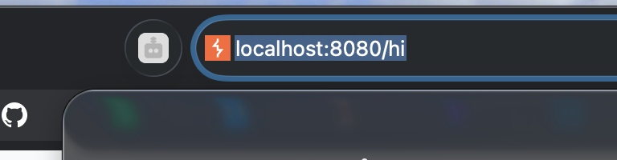
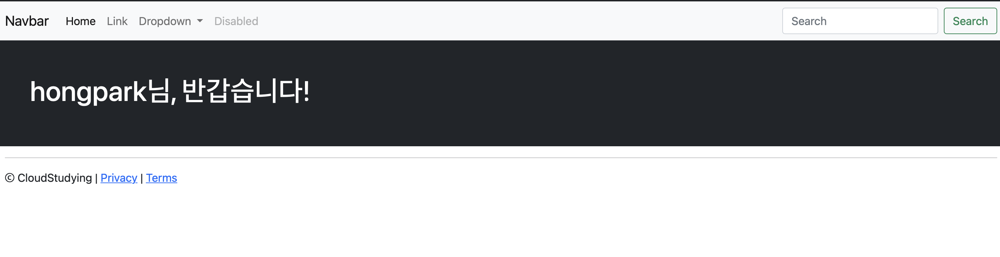
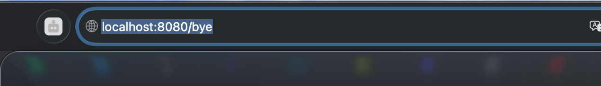
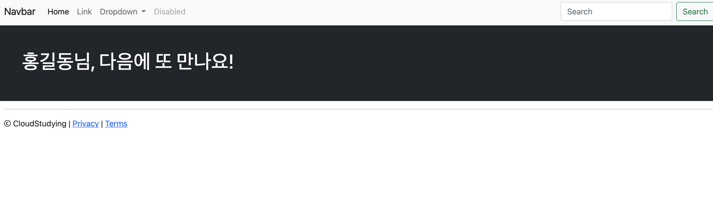

# Week 10

## 스프링 부트 1~2장

이번 주에는 교재 공식 GitHub 저장소의 예제 코드를 보고 따라서 실습함.

https://github.com/gilbutITbook/080354

- 예제 프로젝트를 내 컴퓨터에서 실행함. (JDK 17, Gradle 8.1.1)
- `localhost:8080/hi`, `localhost:8080/bye`에 접속해 결과를 확인함.
- MVC 패턴(`@Controller`, `@GetMapping`, `Model`)과 머스테치 뷰 템플릿, 헤더-푸터 레이아웃을 실습함.

## 실행 결과

